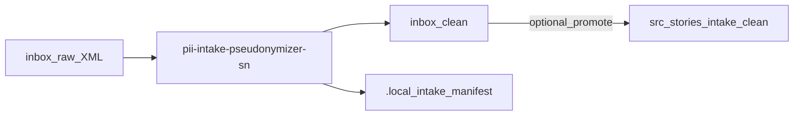

# PII Intake Pseudonymizer (ServiceNow workflow)

Offline CLI that scrubs ServiceNow XML record exports before they reach shared remotes, chat, or AI tools. Markdown and other text beside those exports work the same way.

[Quick start](#quick-start) · [Supported files](#supported-files) · [Scrub methods](#scrub-methods) · [Getting started](docs/getting-started.md) · [Releases](https://github.com/alkitect/pii-intake-pseudonymizer-sn/releases) · [License](#license)

Latest: see [CHANGELOG.md](CHANGELOG.md) and [GitHub Releases](https://github.com/alkitect/pii-intake-pseudonymizer-sn/releases). A plain `git clone` follows the default branch tip unless you check out a tag. Prefer a tagged release for day-to-day use.

[](https://ko-fi.com/alkitect/?hidefeed=true&widget=true&embed=true)

## What this does

### Why privacy matters

ServiceNow unload and record XML often carries emails, display names, and company identifiers in field values. Commit that file, paste it into chat, or hand it to a coding agent / hosted model, and real people leave with it.

Use this CLI so personal and company data stay local until rewritten to stable fake tokens. Share or analyze the scrubbed copy. Keep the encrypted map and raw quarantine on your machine.

### How to use it

1. Drop raw XML (and optional notes) into `inbox/raw/` (gitignored quarantine).
2. Preview with `--dry-run`, or write scrubbed files to `inbox/clean/`.
3. Optionally `--promote STORY-id` into `src/stories/<STORY-id>/` when your tree uses that layout.
4. Run `--summary` on story docs before push (detect-only commit gate).

Replacements stay stable across runs via an encrypted `./.local/pii-map.json`. That is pseudonymization: reversible with the map key, not a one-way hash, and not a compliance certificate.

Start with `--dry-run` on intake or `--summary` on story docs. Set up a map key before any real write ([Configure](#configure)).

### Supported files

| Role | Extensions |
|------|------------|
| Primary | `.xml` (ServiceNow unload / record exports) |
| Also scrubbed | `.md`, `.txt`, `.html`, `.htm`, `.json`, `.js`, `.eml`, `.csv`, `.tsv`, `.log`, `.yml`, `.yaml` |
| Extensionless | treated as text when the path has no suffix |
| Skipped (not scrubbed) | `.xlsx`, `.xls`, `.pdf` (export to CSV/TSV or XML first) |

Same CLI and map for every scrubbed type. Mixed folders under `inbox/raw/` are fine.

### Scrub methods

Default pass (stdlib, no extras):

| Method | Typical tokens | Notes |
|--------|----------------|-------|
| Emails | `user_NNN@example.test` | Always on |
| Person fields from XML/JSON/CSV | `PERSON_NNN` | Harvest rules in config |
| Org / product names | `ORG_NNN` | From `config/pii-org-scrub.txt` (on by default) |
| Phones, checksum IBAN | stable placeholders | High-confidence leftovers can block a write |
| Other optional detectors | IP, NL id, MAC / postcode / DOB | Flagged in [CLI reference](docs/cli-reference.md) |

Opt-in layers (off until you ask):

| Method | Flag | Typical tokens |
|--------|------|----------------|
| Technical scrub (hosts, paths, shell lines, PEM) | `--also-technical` (or individual `--also-machines` / `--also-paths` / `--also-commands` / `--also-certificates`) | `MACHINE_NNN`, `PATH_NNN`, `CMD_NNN`, `CERT_NNN` |
| Free-text person names (Presidio NER) | `--ner` (+ `requirements-pii-ner.txt`) | `PERSON_NNN` |
| Ephemeral tokens, no map write | `--irreversible` | One-shot share; not stable across runs |

Modes:

| Mode | Use when |
|------|----------|
| `--dry-run` | Preview intake replacements; no output or map writes |
| `--summary` | Detect-only gate on `src/stories/...` (refused on `inbox/raw`) |
| Real write | Key required; writes `inbox/clean/`; deletes raw unless `--keep-raw` |
| `--promote STORY-id` | After a successful write, merge clean files into the story tree |

Token samples: [examples](docs/examples/README.md). Full flags: [CLI reference](docs/cli-reference.md).

## Who this is for

People who export ServiceNow records as XML and need those files scrubbed locally before they leave the machine, enter a shared story tree, or get pasted into AI chat / agent workflows.

Not for certified de-identification pipelines, scrubbing old git history, or converting spreadsheets and PDFs in place.

## Quick start

Install puts wrappers on `~/.local/bin` and copies scripts under `~/.local/share/pii-intake-pseudonymizer-sn/`. You still create a map key before a real write, and you still decide when to `--promote`. Longer walkthrough: [docs/getting-started.md](docs/getting-started.md).

Then: [Install](#install) → [Try detect-only](#try-detect-only) → [Real write](#real-write).

### Install

Needs: Python 3.10+, `pip`, and a POSIX shell for `install-to-local.sh` (Windows: Git Bash or WSL). Put `~/.local/bin` on your `PATH`. File types: [Supported files](#supported-files). Offline at intake time.

Stable path: clone or download a tag from [Releases](https://github.com/alkitect/pii-intake-pseudonymizer-sn/releases). Tip of `main` is fine for contributors.

```bash
git clone https://github.com/alkitect/pii-intake-pseudonymizer-sn.git
cd pii-intake-pseudonymizer-sn
# optional: git checkout v0.2.3
./scripts/install-to-local.sh
python -m pip install -r requirements-pii.txt pytest
```

Re-run `./scripts/install-to-local.sh` after `git pull` so the installed copy matches the tree.

### Try detect-only

No map key yet. Drop a tiny unload-style XML into quarantine, preview intake, then (optional) exercise the commit gate on a markdown note:

```bash
mkdir -p inbox/raw inbox/clean .local src/stories/STORY-1000/docs

cat > inbox/raw/sample.xml <<'EOF'
<?xml version="1.0"?>
<unload>
  <sys_user action="INSERT_OR_UPDATE">
    <name display_value="Jane Doe">sysid001</name>
    <email>jane.doe@example.com</email>
  </sys_user>
</unload>
EOF

# Intake preview on XML (no writes)
pii-intake-pseudonymizer-sn inbox/raw --dry-run

# Optional: commit-gate demo on markdown under the story tree
echo 'Contact jane.doe@example.com for access.' > src/stories/STORY-1000/docs/note.md
pii-intake-pseudonymizer-sn src/stories/STORY-1000/docs --summary
```

`--summary` implies `--dry-run` and `--fail-on-hits`. A non-zero exit when hits exist means the gate worked, not that install failed.

### Real write

Key required ([Configure](#configure)). A real pass deletes raw files unless you pass `--keep-raw`. Add `--also-technical` when the drop includes hostnames, paths, shell lines, or PEM blocks:

```bash
python -c "from cryptography.fernet import Fernet; print(Fernet.generate_key().decode())" \
  > ~/.config/servicenow-pii/pii-map.key
chmod 600 ~/.config/servicenow-pii/pii-map.key   # Unix

export PII_MAP_KEY_FILE="$HOME/.config/servicenow-pii/pii-map.key"
pii-intake-pseudonymizer-sn inbox/raw --promote STORY-1000
# or: pii-intake-pseudonymizer-sn inbox/raw --also-technical --promote STORY-1000

grep user_001 inbox/clean/sample.xml   # expect user_001@example.test
```

Omit `--promote STORY-1000` if you only need `inbox/clean/`. Expect `jane.doe@example.com` to become `user_001@example.test`, and display names to become `PERSON_001`.

## Check it works

Dry-run on XML should list replacements without new files under `inbox/clean/`. After a keyed write, `inbox/clean/sample.xml` should contain `user_001@example.test` and not the original address. If you use `--summary` on story markdown with leftover PII, a non-zero exit is success for the gate.

<details>
<summary>Optional confirmation scripts</summary>

```bash
verify-pii-intake-pseudonymizer-sn   # unit tests from this clone, not your sample file
bash scripts/ci-check.sh            # maintainers / release gate
```

</details>

Questions or a stuck install: open a GitHub [Issue](https://github.com/alkitect/pii-intake-pseudonymizer-sn/issues) or see [CONTRIBUTING.md](CONTRIBUTING.md).

## Support my work

Tip jar for the next offline privacy fix. Or a coffee so the next script stays boring on purpose.

[](https://ko-fi.com/alkitect/?hidefeed=true&widget=true&embed=true)

## Uninstall

```bash
./scripts/uninstall-from-local.sh
```

Removes the `~/.local/bin` wrappers and the share tree under `~/.local/share/pii-intake-pseudonymizer-sn/`. Your clone, `inbox/`, `.local/pii-map.json`, and key file stay unless you delete them yourself.

## Configure

Generate a Fernet key once and keep it outside cloud sync. Prefer `PII_MAP_KEY_FILE` over inline `PII_MAP_KEY` so the key is less likely to land in shell history:

```bash
mkdir -p ~/.config/servicenow-pii
python -c "from cryptography.fernet import Fernet; print(Fernet.generate_key().decode())" \
  > ~/.config/servicenow-pii/pii-map.key
chmod 600 ~/.config/servicenow-pii/pii-map.key   # Unix
export PII_MAP_KEY_FILE="$HOME/.config/servicenow-pii/pii-map.key"
```

- `PII_MAP_KEY` - raw Fernet key (avoid in interactive shells)
- `PII_MAP_KEY_FILE` - path to a file containing the Fernet key

If neither env var is set, the CLI auto-loads a platform default when that file already exists:

- Windows: `%LOCALAPPDATA%/ServiceNow-PII/pii-map.key`
- Linux/macOS: `~/.config/servicenow-pii/pii-map.key`

Allowlist, org scrub, and person-field harvest: [docs/configuration.md](docs/configuration.md). Use `--irreversible` when you need ephemeral tokens with no map write for an external share.

Optional NER extras:

```bash
python -m pip install -r requirements-pii-ner.txt
pii-intake-pseudonymizer-sn inbox/raw --ner --dry-run
```

NER stays off unless you pass `--ner` (`ner=skipped` without the extras).

## How it works

Intake reads quarantine under `inbox/raw/`, runs the default scrub (plus any opt-in flags), writes `inbox/clean/`, records checksums in an intake manifest, and optionally merges into `src/stories/<STORY-id>/`. The encrypted map under `.local/` keeps the same real value mapped to the same token on later runs.



Docs: [Getting started](docs/getting-started.md) · [Documentation index](docs/README.md) · [Repo layout](docs/repo-layout.md) · [Architecture](docs/architecture/README.md) · [Commit gate](docs/commit-gate.md)

## Limits & safety

A non-dry-run write can rewrite local files.

- Privacy intent: scrub before share, push, chat, or agent context. This does not scrub git history or content already pasted into a model.
- Platform: offline CLI. Default path is `inbox/raw` → `inbox/clean`. See [Supported files](#supported-files) and [Scrub methods](#scrub-methods).
- Do not point agents or editors at `inbox/raw` until it is pseudonymized. Use `--summary` as a commit gate on `src/stories/` docs when you use that layout.
- Keep `inbox/raw/` and `.local/` out of git. Only pseudonymized paths under `src/stories/` should reach shared remotes ([repo layout](docs/repo-layout.md)).
- Kill-switches: `--dry-run` / `--summary` block output and map writes. `./scripts/uninstall-from-local.sh` removes installed wrappers.
- `--summary` on `inbox/raw` is refused (intake vs commit gate). Default write without `--also-technical` leaves hostnames, paths, commands, and PEM blocks intact.
- Stable tokens need a persistent encrypted map. Deleting `./.local/pii-map.json` changes future pseudonyms for the same inputs.
- Not a compliance product. See [Security](docs/security.md).
- This GitHub repo is the release source for tagged releases and public docs. See [CONTRIBUTING.md](CONTRIBUTING.md).

More docs: [docs/README.md](docs/README.md) · [Getting started](docs/getting-started.md) · [CLI reference](docs/cli-reference.md)

## License

MIT — see [LICENSE](LICENSE).

Optional tip jar: [ko-fi.com/alkitect](https://ko-fi.com/alkitect/?hidefeed=true&widget=true&embed=true)
