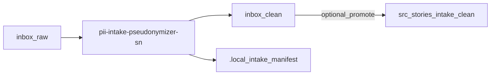

# PII Intake Pseudonymizer (ServiceNow workflow)

Offline CLI that turns ServiceNow-style story exports into shareable, pseudonymized story docs: quarantine in `inbox/raw/`, rewrite PII to stable tokens in `inbox/clean/`, then promote into `src/stories/` when ready.

[Quick start](#quick-start) · [Getting started](docs/getting-started.md) · [Releases](https://github.com/alkitect/pii-intake-pseudonymizer-sn/releases) · [License](#license)

Latest: see [CHANGELOG.md](CHANGELOG.md) and [GitHub Releases](https://github.com/alkitect/pii-intake-pseudonymizer-sn/releases). A plain `git clone` follows the default branch tip unless you check out a tag. Prefer a tagged release for day-to-day use.

[](https://ko-fi.com/alkitect/?hidefeed=true&widget=true&embed=true)

## What this does

ServiceNow and Jira exports often bury emails, display names, org strings, and IPs in free text. If that lands under `src/stories/` and gets pushed, real people ride along in git history.

**What you get:**

1. **Quarantine** - put raw exports in `inbox/raw/` (kept out of git).
2. **Stable tokens** - rewrite to fake ids that stay the same across runs (`jane@…` keeps becoming `user_001@…`) via an encrypted map under `.local/`.
3. **Promote when clean** - optional `--promote STORY-id` copies verified clean files into the story tree.
4. **Commit gate** - `--summary` on story docs finds leftover PII before you push (detect-only; no writes).

That is pseudonymization: reversible with the map key, not a one-way hash and not a compliance certificate.

Start with `--dry-run` on intake or `--summary` on story docs. Set up a map key before any real write ([Configure](#configure)).

## Who this is for

People who keep ServiceNow or Jira story work in a local monorepo shaped like `inbox/raw` + `src/stories/<STORY-id>/`, and need offline scrubbing before anything hits a shared remote.

Not for certified de-identification pipelines, scrubbing old git history, or converting `.xlsx` / `.pdf` in place (export those to text first).

## Quick start

Install puts wrappers on `~/.local/bin` and copies scripts under `~/.local/share/pii-intake-pseudonymizer-sn/`. You still create a map key before a real write, and you still decide when to `--promote` into a story. Longer walkthrough: [docs/getting-started.md](docs/getting-started.md).

Then: [Install](#install) → [Try detect-only](#try-detect-only) → [Real write](#real-write).

### Install

Needs: Python 3.10+, `pip`, and a POSIX shell for `install-to-local.sh` (Windows: Git Bash or WSL). Put `~/.local/bin` on your `PATH`. Text, markdown, XML, and JSON work; `.xlsx` / `.pdf` are skipped. Offline at intake time.

Stable path: clone or download a tag from [Releases](https://github.com/alkitect/pii-intake-pseudonymizer-sn/releases). Tip of `main` is fine for contributors.

```bash
git clone https://github.com/alkitect/pii-intake-pseudonymizer-sn.git
cd pii-intake-pseudonymizer-sn
# optional: git checkout v0.2.2
./scripts/install-to-local.sh
python -m pip install -r requirements-pii.txt pytest
```

Re-run `./scripts/install-to-local.sh` after `git pull` so the installed copy matches the tree.

### Try detect-only

No map key yet. Quarantine sample text, preview intake, then exercise the commit gate on story docs:

```bash
mkdir -p inbox/raw inbox/clean .local src/stories/STORY-1000/docs
echo 'Contact jane.doe@example.com for access.' > inbox/raw/sample.txt

# Intake preview (no writes)
pii-intake-pseudonymizer-sn inbox/raw --dry-run

# Commit-gate demo: unpseudonymized text under story docs (non-zero exit = hits found)
cp inbox/raw/sample.txt src/stories/STORY-1000/docs/sample.md
pii-intake-pseudonymizer-sn src/stories/STORY-1000/docs --summary
```

`--summary` implies `--dry-run` and `--fail-on-hits`. A non-zero exit when hits exist means the gate worked, not that install failed.

### Real write

Key required ([Configure](#configure)). A real pass deletes raw text unless you pass `--keep-raw`:

```bash
python -c "from cryptography.fernet import Fernet; print(Fernet.generate_key().decode())" \
  > ~/.config/servicenow-pii/pii-map.key
chmod 600 ~/.config/servicenow-pii/pii-map.key   # Unix

export PII_MAP_KEY_FILE="$HOME/.config/servicenow-pii/pii-map.key"
pii-intake-pseudonymizer-sn inbox/raw --promote STORY-1000

grep user_001 inbox/clean/sample.txt   # expect user_001@example.test
```

Omit `--promote STORY-1000` if you only need `inbox/clean/`. Expect `jane.doe@example.com` → `user_001@example.test` and display names → `PERSON_001` (more in [examples](docs/examples/README.md)).

## Check it works

You should see the dry-run list replacements without new files under `inbox/clean/`, and `--summary` on story docs should exit non-zero when sample PII is still present. After a keyed write, `grep` should find `user_001@example.test` in the clean output.

<details>
<summary>Optional confirmation scripts</summary>

```bash
verify-pii-intake-pseudonymizer-sn   # unit tests from this clone, not your sample file
bash scripts/ci-check.sh            # maintainers / release gate
```

</details>

Questions or a stuck install: open a GitHub [Issue](https://github.com/alkitect/pii-intake-pseudonymizer-sn/issues) or see [CONTRIBUTING.md](CONTRIBUTING.md).

## Support my work

Tip jar for the next offline privacy fix. Or a coffee so the next script stays boring on purpose.

[](https://ko-fi.com/alkitect/?hidefeed=true&widget=true&embed=true)

## Uninstall

```bash
./scripts/uninstall-from-local.sh
```

Removes the `~/.local/bin` wrappers and the share tree under `~/.local/share/pii-intake-pseudonymizer-sn/`. Your clone, `inbox/`, `.local/pii-map.json`, and key file stay unless you delete them yourself.

## Configure

Generate a Fernet key once and keep it outside cloud sync. Prefer `PII_MAP_KEY_FILE` over inline `PII_MAP_KEY` so the key is less likely to land in shell history:

```bash
mkdir -p ~/.config/servicenow-pii
python -c "from cryptography.fernet import Fernet; print(Fernet.generate_key().decode())" \
  > ~/.config/servicenow-pii/pii-map.key
chmod 600 ~/.config/servicenow-pii/pii-map.key   # Unix
export PII_MAP_KEY_FILE="$HOME/.config/servicenow-pii/pii-map.key"
```

- `PII_MAP_KEY` - raw Fernet key (avoid in interactive shells)
- `PII_MAP_KEY_FILE` - path to a file containing the Fernet key

If neither env var is set, the CLI auto-loads a platform default when that file already exists:

- Windows: `%LOCALAPPDATA%/ServiceNow-PII/pii-map.key`
- Linux/macOS: `~/.config/servicenow-pii/pii-map.key`

Allowlist, org scrub, and person-field harvest: [docs/configuration.md](docs/configuration.md). Use `--irreversible` when you need ephemeral tokens with no map write for an external share.

Optional NER extras:

```bash
python -m pip install -r requirements-pii-ner.txt
pii-intake-pseudonymizer-sn inbox/raw --ner --dry-run
```

NER stays off unless you pass `--ner` (`ner=skipped` without the extras).

## How it works

Intake reads quarantine under `inbox/raw/`, writes clean staging under `inbox/clean/`, records checksums in an intake manifest, and optionally merges into `src/stories/<STORY-id>/`. The encrypted map under `.local/` keeps the same real value mapped to the same token on later runs.



Docs: [Getting started](docs/getting-started.md) · [Documentation index](docs/README.md) · [Repo layout](docs/repo-layout.md) · [Architecture](docs/architecture/README.md) · [Commit gate](docs/commit-gate.md)

## Limits & safety

A non-dry-run write can rewrite local files.

- Platform: offline CLI. Default path is `inbox/raw` → `inbox/clean`.
- Do not point agents or editors at `inbox/raw` until it is pseudonymized. Use `--summary` as a commit gate on `src/stories/` docs.
- Keep `inbox/raw/` and `.local/` out of git. Only pseudonymized story paths should reach shared remotes ([repo layout](docs/repo-layout.md)).
- Kill-switches: `--dry-run` / `--summary` block output and map writes. `./scripts/uninstall-from-local.sh` removes installed wrappers.
- `--summary` on `inbox/raw` is refused (intake vs commit gate). Default write without `--also-technical` leaves hostnames, paths, commands, and PEM blocks intact.
- Stable tokens need a persistent encrypted map. Deleting `./.local/pii-map.json` changes future pseudonyms for the same inputs.
- Logs, PEM drops, or shell snippets in `inbox/raw/` need `--also-technical` on the intake write pass.
- Not a compliance product: no git-history scrub, no binary conversion, and nothing already pasted into chat. See [Security](docs/security.md).
- This GitHub repo is the release source for tagged releases and public docs. See [CONTRIBUTING.md](CONTRIBUTING.md).

More docs: [docs/README.md](docs/README.md) · [Getting started](docs/getting-started.md) · [CLI reference](docs/cli-reference.md)

## License

MIT — see [LICENSE](LICENSE).

Optional tip jar: [ko-fi.com/alkitect](https://ko-fi.com/alkitect/?hidefeed=true&widget=true&embed=true)
